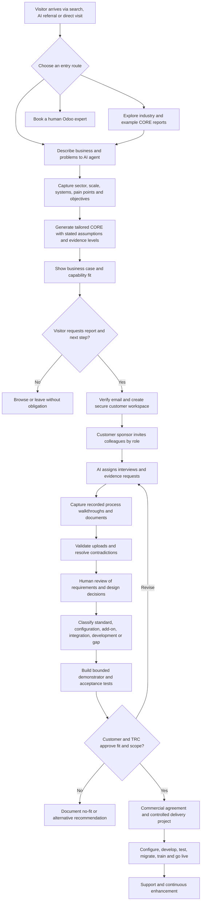

# Project Moonshot: CORE to ERP Delivery Workflow

Source: TRC team walkthrough, October 2026, text 49.txt (approximately 42 minutes).
Audience: Alex, Honey, Ryan, Richie, Dereck and the delivery team.
Status: Working process specification extracted from a discussion. This is not a tested or approved technical architecture.

## Purpose

Replace the meeting-heavy ERP discovery journey with an evidence-led, asynchronous customer journey: prospect describes their business, receives a tailored CORE (Current Operations Review and Enhancement), enters a secure shared project workspace, and contributes verifiable information that can drive scope, configuration, integration, testing and implementation. Human experts review important conclusions and approvals.

## End-to-end journey

## Workflow specifications

### 1. Discovery entry

- Customer can speak or type freely, explore an industry journey, inspect sample reports, or book a human expert.
- Agent asks what is not working, current systems, organization size, locations, priority outcomes and material constraints.
- Avoid promising capability or savings based only on the first statement.

### 2. Generate CORE

- Produce a business summary, what works, operational problems, financial implications, desired outcomes, recommendations, capability classification, uncertainties, required evidence and a proof-before-commitment plan.
- Distinguish information the customer stated, TRC hypotheses, official product documentation and functionality TRC has actually tested.
- Financial benefit scenarios must show assumptions and method, not be represented as guaranteed savings.

### 3. Deliver report and create workspace

- On explicit request, collect and verify customer contact details.
- Send a report link through email and create a customer-specific project area on the Odoo-connected platform. This was described as a webpage/workspace, not a dedicated Odoo ERP instance.
- Workspace should carry the CORE forward as a versioned project record rather than discarding the original conversation.
- The meeting explicitly rejected relying on a hard-to-guess URL as the sole safeguard. Require real authentication, tenant isolation and role-based authorization. A JPEG or noindex is not a security boundary.

### 4. Invite stakeholders and allocate work

- Named project sponsor or administrator invites finance, purchasing, sales, manufacturing, operations and other relevant stakeholders.
- Define which reports or stages each person can view, edit, upload or approve.
- AI asks focused questions by role, e.g. a purchasing manager describes receiving, approval exceptions, suppliers and outputs.
- Set work packages with ownership, expected effort, due dates and completion criteria.

### 5. Gather actual operational evidence

- Collect reports, sample forms, invoice layouts, stock/production data, machine manuals, interface specifications and screen recordings with narration.
- Encourage multiple people who execute the same process to demonstrate it independently to expose differences and exceptions.
- For recorded workflows, capture what the user does, why they do it, decisions made, exceptions and the next person's handoff.
- GoTestify was identified during the meeting as a potential recording and analysis engine. Its suitability and integration are not yet validated.

### 6. Validate and structure information

- Inspect each upload against an explicit schema or checklist. Example from meeting: reject a file missing the required barcode column and explain how to correct it.
- Flag conflicting stakeholder accounts, missing information, unverified interfaces and material assumptions.
- Human reviewer can correct an AI's misunderstanding before requirements are published as accepted.

### 7. Map to actual Odoo capability

- For every requirement identify: standard, configuration, supported add-on, external integration, proposed TRC module, or not yet verified.
- Record product version, edition, hosting, official evidence, constraints, accountable reviewer and proof test.
- Do not treat an AI-generated module or an IoT integration as feasible until it has been tested with representative equipment and data.

### 8. Demonstrate proof before commitment

- Pick a bounded, representative product family or operational path.
- Configure or construct a working demonstration against actual customer artifacts, with observable pass/fail acceptance criteria.
- Demonstrate critical exceptions and capture elapsed time and the effort TRC spends.
- Customer can approve, ask for revision, or receive an honest no-fit recommendation.

### 9. Transition into execution

- Reveal additional methodology and delivery stages only when the customer formally progresses.
- Preserve the full evidence trail through scope, data migration, tests, configuration decisions, integration checks, approvals, training and go-live.
- AI accelerates capture and routine checking; accountable humans retain design authority, commercial and operational acceptance.

## Architecture and security questions for Alex

1. Odoo website/portal and external middleware: where do customer workspaces and record versions reside?
2. Identity and authorization: customers, sponsor invitation, least-privilege access and revocation.
3. Multi-tenant data separation, encryption, retention, audit trail and export/deletion.
4. Email verification, invitation links, upload limits, malware scanning and sensitive data masking.
5. CORE versioning and mapping to lead/opportunity, requirements, project, issues and tests.
6. AI workflow orchestration, retries, monitoring, model provenance and human approval gates.
7. Evidence capture partner integration, especially export formats, timestamps and API/webhook capability.
8. Version-specific Odoo deployment, upgrade and custom-module support.

## First acceptance pilot

Select one representative manufacturing story, invite three simulated roles, gather narrated workflow recordings and two sample documents, generate a checked requirements register, build one working proof, then compare implementation hours and accuracy with TRC's normal approach.

## Transcript anchors

00:03-05:06 website, CORE and product gap explanation; 10:01-15:39 secure project area and AI evidence validation; 28:38-30:39 Alex workflow request and access controls; 31:42-38:59 role interviews, narrated recording and GoTestify idea.
