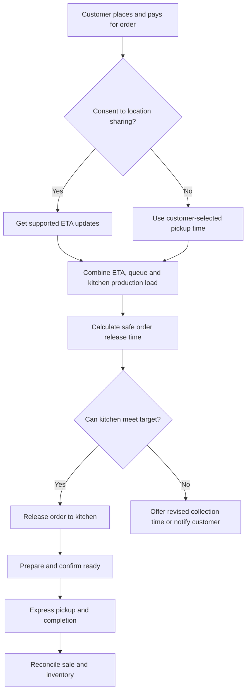

# Project Moonshot: Mundo Coffee Demonstration Brief

Source: TRC meeting transcript, approximately 19:01 to 22:12.
Status: Concept to be tested, not a client requirement and not an established Odoo capability.
Brand: Mundo Coffee is used as an illustrative, fictional global coffee chain scenario; do not imply affiliation with Starbucks or present third-party statements as established without verification.

## Customer outcome

A customer pays for an order before arrival and, if they consent to location use, receives prepared food or drink at the right moment without joining the normal drive-thru queue.

## Proposed customer journey

1. Customer selects a nearby participating location in the ordering app.
2. Customer chooses items, pays and optionally consents to live location sharing.
3. System estimates arrival time, current kitchen preparation time, queue length and location throughput.
4. Order-release engine decides when to send the paid order into the kitchen queue, with a target that minimizes waiting while avoiding food going cold.
5. Kitchen receives, accepts and prepares the order.
6. Customer is told when to use an express pickup route and receives collection instructions.
7. Order is collected, marked complete and reconciled into POS, inventory and accounting.

## What the transcript actually establishes

- The team proposed WhatsApp live location as a possible source and described dynamically releasing a prepaid order around 15 minutes before arrival in an example.
- The '15 minutes' was an illustrative value, not a validated lead time, service-level commitment or fixed rule.
- The idea is intended as a test of AI-assisted specification and rapid development from plain-language requirements.

## What must be verified before implementation

- Whether a consumer's live WhatsApp location can be lawfully and technically integrated with a third-party business application in the required way. Do not assume the WhatsApp Business Platform provides live location-stream access.
- Alternative: explicit location permissions in a branded mobile or web app, subject to OS policies and privacy requirements.
- Availability of real queue telemetry, kitchen display integration, POS APIs, order status and site capacity.
- Food preparation times by item, perishability and hold-time limits.
- Consent, minimization, revocation and deletion of location data.
- Fraud, cancellations, refunds, late customers, sudden traffic changes and poor network connectivity.
- Correct separation between native Odoo behavior, supported integrations and custom work.

## Bounded proof proposed for Richie, Ryan and Alex

- Use one mock venue, 10 illustrative products, a simulated kitchen queue and a simulated changing ETA.
- Demonstrate the release algorithm and handling of one delayed customer and one overloaded kitchen.
- Report build time, unresolved platform gaps, implementation risks, and test outcomes.
- Do not claim a production implementation from a UI mockup alone.

## Acceptance checks

- An early customer arrival cannot force an impossible preparation deadline.
- Delayed ETA can postpone release where safe; late changes after preparation trigger an appropriate alert.
- Every released order is traceable to a valid payment and unique order ID.
- Users who decline location sharing still have a usable pickup experience.
- Store staff can override scheduling with an audit trail.

## Transcript anchors

19:01 fictional enterprise example; 19:43-22:12 live-location and express pickup idea; 20:27-20:45 instruction to test on a clean Odoo environment.
